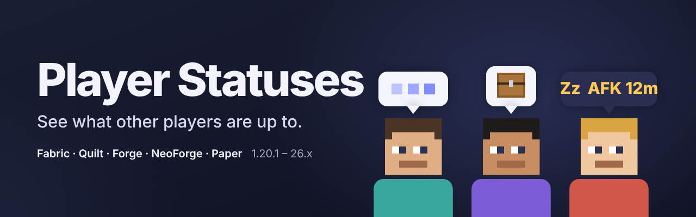

# Player Statuses

**English** · [Русский](README.ru.md)

See what other players are up to: a small icon above their heads shows when they are **typing**, have their **inventory or a chest open**, are **AFK** (with a timer) or have **tabbed out**. Works with the mod on the server, or on Paper / Purpur / Folia / Spigot with the plugin, which also shows what it can to players without the mod.

> **In development.** The first release is being built. Today the mod loads on every version below and the server side answers `/playerstatuses` and `/afk`; the icons above heads, the network link and the plugin's bridge come next. This page describes the mod as it will be in its first release.

## Contents

- [What you see](#what-you-see)
- [Privacy](#privacy)
- [What works where](#what-works-where)
- [Versions and files](#versions-and-files)
- [Commands](#commands)
- [Settings](#settings)
- [Compatibility](#compatibility)
- [Questions and problems](#questions-and-problems)
- [Building](#building)

## What you see

A small icon above a player's head, in the style of Minecraft's own interface, that never covers the name:

| Status | When |
|---|---|
| **Typing…** | the player is typing in chat; a different icon while typing a command. What they type is never sent |
| **Inventory** | their inventory is open (survival or creative) |
| **Crafting, chest, furnace, enchanting, anvil, trading** | a work block or a container is open |
| **Reading** | a book, a sign or a full-screen map |
| **Paused, settings** | the pause menu or the settings |
| **Busy** | a screen of another mod (emote wheels and similar menus do not count) |
| **AFK 12m** | no input for a few minutes, with how long |
| **Tabbed out** | the game window is minimised or in the background |
| **Loading** | going to another dimension |
| **Microphone / sound off** | with Simple Voice Chat installed (it already shows who is talking and groups; this adds what it does not) |

The same status shows next to the name in the player list (Tab), with the AFK time. Players who type or have their inventory open move their arms a little; that can be turned off.

## Privacy

- The text you type is never sent, only that you are typing.
- Every kind of status has its own switch: hide that you are in your inventory, that you are AFK or tabbed out, anything.
- A separate set of switches decides which statuses of others you see.
- Invisible players never show an icon; sneaking players hide it unless you turn that off.

## What works where

| Client | Server | Result |
|---|---|---|
| mod | mod (Fabric, Forge, NeoForge) | everything |
| mod | Paper / Purpur / Folia / Spigot with the plugin | everything |
| mod | without the mod or plugin | nothing is sent and nothing is shown; the mod stays quiet |
| no mod | mod or plugin | players without the mod see nothing new, but players with the mod see their AFK time and open containers, which the server detects itself |
| no mod | mod or plugin, with the server's setting on | statuses are visible to vanilla clients too: a text line above the head on 1.19.4+, the player list on older versions |

## Versions and files

One file covers every Minecraft version of its loader: it picks the right build when the game starts.

| File | For | Minecraft | Java |
|---|---|---|---|
| `player-statuses-fabric-<version>+mc1.21.9-26.x.jar` | Fabric, Quilt (needs [Fabric API](https://modrinth.com/mod/fabric-api)) | 1.21.9 – 1.21.11, 26.1 – 26.3 | 21+ (26.x: 25) |
| `player-statuses-forge-neoforge-<version>+mc1.20.1-26.x.jar` | Forge, NeoForge | Forge 1.20 – 1.20.1, 1.21.9 – 26.3; NeoForge 1.20.1, 1.21 – 1.21.1, 1.21.9 – 26.3 | 17+ (26.x: 25) |
| `player-statuses-bukkit-<version>.jar` | Paper, Purpur, Folia, Spigot, Bukkit | 1.16.5 – 26.3 | 8+ |

Put the mod into `.minecraft/mods/` (and into the server's `mods/` for the server side); the plugin into the server's `plugins/`. Older Minecraft versions (1.16.5 – 1.21.8 for the mod) come in later releases.

## Commands

| Command | Who | What it does |
|---|---|---|
| `/playerstatuses` | everyone | version, how many players have the mod, the server's settings and your own status |
| `/playerstatuses reload` | operators (`playerstatuses.admin` on Bukkit) | reads the settings file again (it is also picked up a few seconds after you save it) |
| `/playerstatuses help` | everyone | the list of commands |
| `/afk` | everyone (`playerstatuses.afk` on Bukkit) | marks you AFK until you move or run it again. A server can turn it off; then another plugin's `/afk` keeps working |

Replies come in each player's game language.

## Settings

### Client: `config/playerstatuses.properties`

| Key | Default | What it does |
|---|---|---|
| `send_typing`, `send_inventory`, `send_blocks`, `send_reading`, `send_menus`, `send_other_screens`, `send_loading`, `send_afk`, `send_unfocused`, `send_voice` | `true` | let others see that kind of status of yours |
| `show_typing` … `show_voice` (the same names) | `true` | show that kind of status of others |
| `afk_minutes` | `3` | minutes without input after which you count as AFK (1 – 60) |
| `icon_scale` | `100` | size of the icons, percent (50 – 200) |
| `view_distance` | `32` | icons are drawn for players up to this many blocks away (4 – 128) |
| `opacity` | `90` | opacity of the icons, percent (20 – 100) |
| `hide_when_sneaking` | `true` | hide the icon of a sneaking player |
| `show_own` | `false` | show your own icon in third-person view |
| `tab_list` | `true` | statuses and AFK time in the player list |
| `arm_poses` | `true` | arms move while typing or in the inventory |
| `ignored_screens` | emote wheels of Emotecraft, CPM, Yes Steve Model, Figura, Controlify | screens of other mods that never count as busy: class names or package prefixes, comma-separated |

### Server: `config/playerstatuses-server.properties` (plugin: `plugins/PlayerStatuses/playerstatuses-server.properties`)

| Key | Default | What it does |
|---|---|---|
| `afk_command` | `true` | players may use `/afk` |
| `detect_players_without_mod` | `true` | for players without the mod the server shows what it sees itself: AFK and open containers |
| `afk_minutes` | `5` | minutes without moving or acting after which a player without the mod counts as AFK (1 – 120) |
| `language` | `en_us` | language of the console's replies |

A value that cannot be read is reported in the log and the default is used, but the file keeps what you typed. Keys you add yourself stay in the file.

## Compatibility

- **An alternative to What Are They Up To (WATUT).** It shows the same kind of statuses, but only as small icons: no copy of the other player's screen is sent or drawn, so there is nothing to flicker, crash on big packets or slow the game down. It also runs on Minecraft versions WATUT has no build for (1.21.9 – 26.3) and on Paper servers.
- Icons are drawn with the name tags, so shaders (Iris, Oculus) and mods that change name tags or player models (Nametag Tweaks, Figura, Customizable Player Models) keep working.
- Simple Voice Chat is optional.

## Questions and problems

[Open an issue](https://github.com/Shamanalle/player-statuses/issues/new/choose) with the Minecraft, loader and mod versions and, if the game crashed, `logs/latest.log`.

## Building

See [CONTRIBUTING.md](CONTRIBUTING.md): `./gradlew build` puts the three release files into `build/libs/`.

## License

[MIT](LICENSE).
