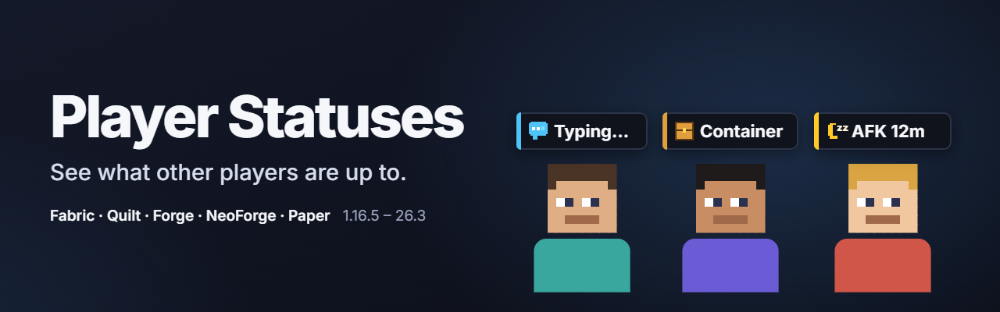

# Player Statuses

**English** · [Русский](README.ru.md)

See what other players are up to: a crisp badge above their heads shows when they are **typing**, have their **inventory or a chest open**, are **AFK** (with a timer) or have **tabbed out**, and within close range it smoothly unfolds into an **interactive 3D holo-projection** in front of them. Works with the mod on the server, or on Paper / Purpur / Folia / Spigot with the plugin, which also shows what it can to players without the mod.

## Contents

- [What you see](#what-you-see)
- [Privacy](#privacy)
- [What works where](#what-works-where)
- [Versions and files](#versions-and-files)
- [Commands](#commands)
- [Settings](#settings)
- [Compatibility](#compatibility)
- [Questions and problems](#questions-and-problems)
- [Building](#building)

## What you see

A crisp dark-slate badge above a player's head, styled after Minecraft's own interface, that never covers their name:

| Status | When |
|---|---|
| **Typing…** | the player is typing in chat; a separate icon appears while entering a command. What they type is never sent |
| **Inventory** | their inventory is open (survival or creative) |
| **Crafting, chest, furnace, enchanting, anvil, trading** | a work block or container is open |
| **Reading** | a book, a sign or a full-screen map |
| **Paused, settings** | the pause menu or game/mod settings |
| **Busy** | a screen of another mod (emote wheels and radial menus are ignored) |
| **AFK 12m** | no input for a few minutes, with an elapsed timer |
| **Tabbed out** | the game window is minimised or unfocused |
| **Loading** | travelling to another dimension |
| **Microphone / sound off** | with Simple Voice Chat installed (complements its talking and group icons) |

The same status appears next to the player's name in the Tab list (preserving team prefixes, colours and formatting) together with AFK time. Players who are typing or browsing a screen subtly animate their arms; this can be turned off.

### Interactive 3D Holo-Projections

When another player comes within `holo_distance` blocks (default `8`), their status smoothly unfolds into a crisp double-sided chest hologram alongside the overhead badge:

- **Procedural live layouts:** renders anonymous vector layouts for inventories (armor, offhand, storage, hotbar), single/double chests, 3x3 crafting grids, furnaces (with smelting progress), enchanting tables, anvils, villager trading, live chat/command typing waveforms, books, signs, maps, and an AFK idle card — complete with a live interpolated cursor and click ripples.
- **Tactile slot pings & Ghost Item Hints (`<= 4.5` blocks):** look at a slot on a nearby player's open menu hologram and press **Use** with an empty hand (or **Sneak + Use** while holding an item, or press the dedicated **Holo-Projection Ping / Call** keybind) to pulse that slot directly inside their open GUI for 4 seconds. Holding an item attaches a **Ghost Item Hint** banner without dropping or moving the item.
- **AFK Call button:** point at the `[ Call ]` button on an AFK player's hologram to nudge them with a soft chime and actionbar alert (`20s` per-target cooldown).

## Privacy

- **Zero screen streaming:** chat, command, book and sign text, as well as actual item types/IDs/NBT in your containers, are **never** transmitted passively — only procedural layout IDs, 4-bit anonymous slot silhouettes (empty / item / uncommon / enchanted / full stack) and normalized cursor coordinates.
- Every category has its own **Privacy** switch, alongside dedicated `Share 3D hologram` (`send_projections`) and `Item silhouettes` (`send_projection_slots`) switches, or toggle everything at once.
- A separate **Visibility** tab controls which statuses of other players are shown on your screen, while **Holo pings** (`allow_holo_pings`) controls whether nearby players can highlight slots in your menus or nudge you while AFK.
- Invisible, vanished, spectator and hidden-nametag team rules are strictly respected; sneaking players hide their badge unless you turn that off.

## What works where

| Client | Server | Result |
|---|---|---|
| mod | mod (Fabric, Forge, NeoForge) | everything |
| mod | Paper / Purpur / Folia / Spigot with the plugin | everything |
| mod | without the mod or plugin | nothing is sent and nothing is shown; the mod stays completely silent |
| no mod | mod or plugin | players without the mod see nothing new unless vanilla display is enabled, while players with the mod see their AFK time and open containers detected by the server |
| no mod | mod or plugin, with vanilla display on | statuses are shown to vanilla clients too: a text line above the head on 1.19.4+ (`TextDisplay`) and next to names in the Tab player list on 1.16.5 – 26.3 |

## Versions and files

One universal file covers every Minecraft version of its loader and selects the matching build automatically at startup.

| File | For | Minecraft | Java |
|---|---|---|---|
| `player-statuses-fabric-<version>+mc1.16.5-26.x.jar` | Fabric, Quilt (needs [Fabric API](https://www.curseforge.com/minecraft/mc-mods/fabric-api)) | 1.16.5 – 1.21.11, 26.1 – 26.3 | 8+ (26.x: 25) |
| `player-statuses-forge-neoforge-<version>+mc1.16.5-26.x.jar` | Forge, NeoForge | Forge 1.16.5, 1.17.1 – 1.21.11, 26.1 – 26.3; NeoForge 1.20.1 – 1.21.11, 26.1 – 26.3 | 8+ (26.x: 25) |
| `player-statuses-bukkit-<version>.jar` | Paper, Purpur, Folia, Spigot, Bukkit | 1.16.5 – 26.3 | 8+ |

Put the mod into `.minecraft/mods/` (and into the server's `mods/` for a modded server); put the plugin into `plugins/` on Paper, Purpur, Folia or Spigot.

## Commands

| Command | Who | What it does |
|---|---|---|
| `/playerstatuses` | everyone | shows the version, how many players have the mod, the server's settings and your current status |
| `/playerstatuses reload` | operators (`playerstatuses.admin` on Bukkit) | reloads the server settings file immediately (changes on disk are also picked up automatically within a few seconds) |
| `/playerstatuses help` | everyone | lists available commands |
| `/afk` | everyone (`playerstatuses.afk` on Bukkit) | marks you AFK until you move or run `/afk` again. Can be disabled on the server so another plugin's `/afk` takes over cleanly |

Replies are sent in each player's own Minecraft language (13 languages built in).

## Settings

### In-game Settings Screen & `config/playerstatuses.properties`

Open the client settings screen from **Mod Menu** (Fabric / Quilt), **Mods → Config** (Forge / NeoForge), or bind shortcuts in **Options → Controls → Key Binds → Multiplayer** for **Player Statuses Settings** and **Holo-Projection Ping / Call** (both unbound by default so they never conflict with other mods). It features a **Live Preview** card (overhead badge + Tab list preview with a cycle button), **General / Privacy / Visibility** tabs, **Enable all / Disable all** buttons, tooltips and **Reset** to defaults.

| Key | Default | What it does |
|---|---|---|
| `send_typing`, `send_inventory`, `send_blocks`, `send_reading`, `send_menus`, `send_other_screens`, `send_loading`, `send_afk`, `send_unfocused`, `send_voice` | `true` | allow others to see that category of your status |
| `send_projections` | `true` | share your live cursor and procedural 3D hologram layout with nearby players |
| `send_projection_slots` | `true` | include anonymous empty / filled / enchanted slot silhouettes in your 3D hologram |
| `show_typing` … `show_voice` (same suffixes) | `true` | show that category of other players' statuses |
| `afk_minutes` | `3` | minutes without input before you are marked AFK (1 – 60) |
| `icon_scale` | `100` | overhead badge size in percent (50 – 200) |
| `view_distance` | `32` | maximum distance in blocks at which overhead badges render (4 – 128) |
| `opacity` | `90` | overhead badge and hologram opacity in percent (20 – 100) |
| `hide_when_sneaking` | `true` | hide the overhead badge while a player is sneaking |
| `show_own` | `false` | render your own overhead badge in third-person view |
| `tab_list` | `true` | show statuses and AFK timers in the Tab player list |
| `arm_poses` | `true` | animate player arms subtly while typing or using an open screen |
| `holo_projections` | `true` | unfold close-range status badges into interactive 3D panels in front of players |
| `holo_distance` | `8` | distance in blocks at which overhead badges unfold into 3D holograms (4 – 24) |
| `allow_holo_pings` | `true` | let nearby players highlight slots in your open menus or call you while AFK |
| `holo_sound` | `true` | play a soft UI chime when someone pings your menu or calls you |
| `ignored_screens` | emote wheels of Emotecraft, CPM, Yes Steve Model, Figura, Controlify | screens of other mods that never count as busy (comma-separated class names or package prefixes) |

### Server: `config/playerstatuses-server.properties` (plugin: `plugins/PlayerStatuses/playerstatuses-server.properties`)

| Key | Default | What it does |
|---|---|---|
| `afk_command` | `true` | register and allow `/afk` |
| `detect_players_without_mod` | `true` | detect AFK time and open containers on the server for players without the mod |
| `afk_minutes` | `5` | minutes without movement or interaction before a player without the mod counts as AFK (1 – 120) |
| `vanilla_overhead` | `true` | show statuses above heads to vanilla clients on 1.19.4+ (`TextDisplay`) |
| `vanilla_tab_list` | `true` | show statuses in the Tab player list to vanilla clients (`1.16.5 – 26.3`) |
| `language` | `en_us` | language used for console replies and as fallback when a client's locale is unknown |

Invalid values are logged with a warning and fall back to defaults without overwriting your file. Unknown custom keys are preserved.

## Compatibility

- **A lightweight, privacy-preserving alternative to What Are They Up To (WATUT).** Combines clean overhead badges with close-range interactive 3D procedural holograms instead of streaming or rendering screenshots of players' screens — zero framebuffer packets, zero flicker, negligible network and FPS cost, full support for **1.16.5 – 26.3**, and native **Paper / Purpur / Folia** plugin support.
- Overhead badges render alongside name tags, keeping compatibility with shaders (Iris, Oculus) and name-tag or player-model mods (Nametag Tweaks, Figura, Customizable Player Models).
- Simple Voice Chat integration is automatic and completely optional.

## Questions and problems

[Open an issue](https://github.com/Shamanalle/player-statuses/issues/new/choose) with your Minecraft, loader and mod versions and, if the game crashed, `logs/latest.log`.

## Building

See [CONTRIBUTING.md](CONTRIBUTING.md): `./gradlew build` produces all three release JARs in `build/libs/`.

## License

[MIT](LICENSE).
