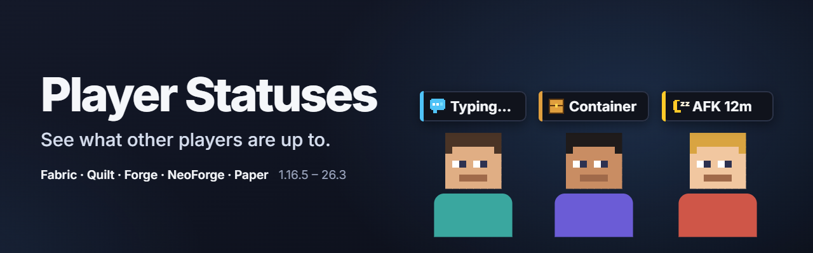

# Player Statuses

[English](README.md) · **Русский**

Видно, чем заняты другие игроки: аккуратный значок над головой показывает, что игрок **печатает**, открыл **инвентарь или сундук**, **АФК** (с таймером) или **свернул игру**. Работает с модом на сервере или на Paper / Purpur / Folia / Spigot с плагином, который показывает статусы в том числе и игрокам без мода.

## Содержание

- [Что видно](#что-видно)
- [Приватность](#приватность)
- [Что где работает](#что-где-работает)
- [Версии и файлы](#версии-и-файлы)
- [Команды](#команды)
- [Настройки](#настройки)
- [Совместимость](#совместимость)
- [Вопросы и проблемы](#вопросы-и-проблемы)
- [Сборка](#сборка)

## Что видно

Контрастная тёмно-графитовая плашка с иконкой над головой игрока в духе интерфейса Minecraft, которая никогда не перекрывает ник:

| Статус | Когда |
|---|---|
| **Печатает…** | игрок пишет в чат; для ввода команды — отдельная иконка. Сам текст никогда не передаётся |
| **Инвентарь** | открыт инвентарь (выживание или творческий режим) |
| **Крафт, сундук, печь, зачарование, наковальня, торговля** | открыт рабочий блок или контейнер |
| **Читает** | открыта книга, табличка или полноэкранная карта |
| **Пауза, настройки** | открыто меню паузы или настройки |
| **Занят** | открыт экран другого мода (колёса эмоций и радиальные меню игнорируются) |
| **АФК 12m** | нет ввода несколько минут, с точным таймером |
| **Свернул игру** | окно игры свёрнуто или находится в фоне |
| **Загрузка** | переход между измерениями |
| **Микрофон / звук выключен** | при установленном Simple Voice Chat (дополняет его собственные иконки разговора и групп) |

Тот же статус отображается рядом с ником в списке игроков (Tab) с сохранением префиксов, цветов и форматирования команд, включая время АФК. Во время набора текста или просмотра инвентаря персонаж слегка двигает руками; при желании это отключается.

## Приватность

- Текст сообщений и команд **никогда** не отправляется — передаётся только тип занятия.
- Во вкладке **Приватность** у каждой категории свой переключатель (плюс кнопки быстрого включения и выключения всех категорий сразу): можно скрыть инвентарь, АФК, свёрнутое окно или любой другой статус.
- Отдельная вкладка **Видимость** управляет тем, какие статусы других игроков отображаются у вас.
- Строго учитываются невидимость, ваниш плагинов, режим наблюдателя и правила скрытия ников команд; у крадущихся игроков (Shift) значок скрывается, если не отключить эту опцию.

## Что где работает

| Клиент | Сервер | Что получится |
|---|---|---|
| мод | мод (Fabric, Forge, NeoForge) | работает всё |
| мод | Paper / Purpur / Folia / Spigot с плагином | работает всё |
| мод | без мода и плагина | ничего не отправляется и не рисуется; мод полностью молчит |
| без мода | мод или плагин | игроки с модом видят время АФК и открытые контейнеры игроков без мода (их определяет сам сервер) |
| без мода | мод или плагин с включённым показом для ванили | статусы видны и ванильным клиентам: строкой текста над головой на 1.19.4+ (`TextDisplay`) и рядом с ником в списке Tab на 1.16.5 – 26.3 |

## Версии и файлы

Один универсальный JAR охватывает все версии Minecraft своего загрузчика и автоматически выбирает нужную сборку при запуске.

| Файл | Для чего | Minecraft | Java |
|---|---|---|---|
| `player-statuses-fabric-<версия>+mc1.16.5-26.x.jar` | Fabric, Quilt (нужен [Fabric API](https://www.curseforge.com/minecraft/mc-mods/fabric-api)) | 1.16.5 – 1.21.11, 26.1 – 26.3 | 8+ (26.x: 25) |
| `player-statuses-forge-neoforge-<версия>+mc1.16.5-26.x.jar` | Forge, NeoForge | Forge 1.16.5, 1.17.1 – 1.21.11, 26.1 – 26.3; NeoForge 1.20.1 – 1.21.11, 26.1 – 26.3 | 8+ (26.x: 25) |
| `player-statuses-bukkit-<версия>.jar` | Paper, Purpur, Folia, Spigot, Bukkit | 1.16.5 – 26.3 | 8+ |

Мод помещается в `.minecraft/mods/` (и в `mods/` модифицированного сервера), плагин — в `plugins/` сервера Paper, Purpur, Folia или Spigot.

## Команды

| Команда | Кто | Что делает |
|---|---|---|
| `/playerstatuses` | все | показывает версию, число игроков с модом, настройки сервера и ваш текущий статус |
| `/playerstatuses reload` | операторы (`playerstatuses.admin` на Bukkit) | сразу перечитывает файл настроек сервера (изменения на диске также подхватываются автоматически через несколько секунд) |
| `/playerstatuses help` | все | выводит список команд |
| `/afk` | все (`playerstatuses.afk` на Bukkit) | отмечает вас АФК до первого движения или повторного ввода `/afk`. Если выключить команду на сервере, она уступает место `/afk` другого плагина |

Ответы сервера приходят каждому игроку на выбранном у него языке игры (встроено 13 языков).

## Настройки

### Внутриигровой экран настроек и `config/playerstatuses.properties`

Открыть настройки клиента можно через **Mod Menu** (Fabric / Quilt), меню **Mods → Config** (Forge / NeoForge) или назначив клавишу в **Настройки → Управление → Назначение клавиш → Сетевая игра → Настройки Player Statuses** (по умолчанию клавиша не назначена, чтобы не конфликтовать с другими модами). В окне есть карточка **живого предпросмотра** (плашка над головой и строка в Tab с кнопкой переключения примеров), вкладки **Общие / Приватность / Видимость**, кнопки **Включить все / Выключить все**, подсказки и **Сброс** к настройкам по умолчанию.

| Ключ | По умолчанию | Что делает |
|---|---|---|
| `send_typing`, `send_inventory`, `send_blocks`, `send_reading`, `send_menus`, `send_other_screens`, `send_loading`, `send_afk`, `send_unfocused`, `send_voice` | `true` | разрешить другим видеть эту категорию вашего статуса |
| `show_typing` … `show_voice` (те же суффиксы) | `true` | показывать эту категорию статусов у других игроков |
| `afk_minutes` | `3` | через сколько минут без ввода вы отмечаетесь АФК (1 – 60) |
| `icon_scale` | `100` | масштаб плашки над головой в процентах (50 – 200) |
| `view_distance` | `32` | максимальная дистанция отрисовки плашек в блоках (4 – 128) |
| `opacity` | `90` | непрозрачность плашек в процентах (20 – 100) |
| `hide_when_sneaking` | `true` | скрывать плашку у крадущегося игрока |
| `show_own` | `false` | показывать собственную плашку в виде от третьего лица |
| `tab_list` | `true` | показывать статусы и таймер АФК в списке игроков (Tab) |
| `arm_poses` | `true` | лёгкая анимация рук при наборе текста и открытых экранах |
| `ignored_screens` | колёса эмоций Emotecraft, CPM, Yes Steve Model, Figura, Controlify | экраны других модов, которые никогда не считаются «занят» (имена классов или префиксы пакетов через запятую) |

### Сервер: `config/playerstatuses-server.properties` (плагин: `plugins/PlayerStatuses/playerstatuses-server.properties`)

| Ключ | По умолчанию | Что делает |
|---|---|---|
| `afk_command` | `true` | регистрировать и разрешать команду `/afk` |
| `detect_players_without_mod` | `true` | определять на сервере АФК и открытые контейнеры у игроков без мода |
| `afk_minutes` | `5` | через сколько минут без движения и действий игрок без мода считается АФК (1 – 120) |
| `vanilla_overhead` | `true` | показывать статусы над головой ванильным клиентам на 1.19.4+ (`TextDisplay`) |
| `vanilla_tab_list` | `true` | показывать статусы в списке игроков (Tab) ванильным клиентам (`1.16.5 – 26.3`) |
| `language` | `en_us` | язык ответов в консоли и запасной язык, если локаль клиента неизвестна |

Некорректные значения отмечаются предупреждением в логе и заменяются значением по умолчанию без перезаписи вашего текста в файле. Пользовательские ключи сохраняются.

## Совместимость

- **Лёгкая альтернатива What Are They Up To (WATUT).** Показывает привычные мультиплеерные статусы компактными значками без пересылки и рендеринга чужого экрана: нет тяжёлых пакетов, мерцания и просадок FPS, поддерживаются **1.16.5 – 26.3** и серверы **Paper / Purpur / Folia**.
- Значки рисуются в одном проходе с никами, поэтому корректно работают с шейдерами (Iris, Oculus) и модами на ники и модели игроков (Nametag Tweaks, Figura, Customizable Player Models).
- Интеграция с Simple Voice Chat подхватывается автоматически и не требует его установки.

## Вопросы и проблемы

[Создайте issue](https://github.com/Shamanalle/player-statuses/issues/new/choose), указав версии Minecraft, загрузчика и мода, а при вылете игры приложите `logs/latest.log`.

## Сборка

См. [CONTRIBUTING.md](CONTRIBUTING.md#русский): `./gradlew build` собирает все три релизных JAR в `build/libs/`.

## Лицензия

[MIT](LICENSE).
