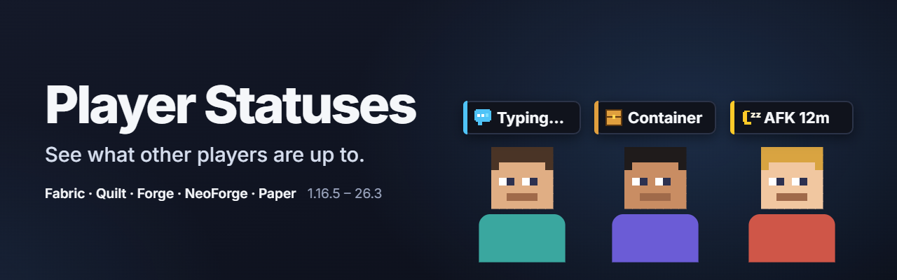

**See what other players are up to.** A small icon above a player's head shows when they are **typing**, have their **inventory or a chest open**, are **AFK** (with a timer) or have **tabbed out**, and the same shows in the player list.

- **Privacy first:** the text you type is never sent, and every kind of status has its own privacy switch.
- **Lightweight:** icons only — no copy of anyone's screen is sent or drawn, so it stays light on the network and on your frame rate.
- **Broad support:** an alternative to *What Are They Up To* (WATUT) for **1.16.5 – 26.3** on **Fabric, Quilt, Forge and NeoForge**, with a plugin for **Paper, Purpur, Folia and Spigot** servers that also shows statuses to vanilla clients.

### What you see

| Status | When |
|---|---|
| **Typing…** | typing in chat or entering a command (the text itself is never sent) |
| **Inventory** | survival or creative inventory open |
| **Crafting, chest, furnace, enchanting, anvil, trading** | a work block or container is open |
| **Reading** | a book, sign or full-screen map |
| **Paused, settings, busy** | pause menu, settings or another mod's screen (emote wheels ignored) |
| **AFK 12m** | no input for a few minutes, with how long |
| **Tabbed out / Loading** | game window unfocused or changing dimensions |
| **Microphone / sound off** | with Simple Voice Chat installed |

### Which file do I need?

| File | For |
|---|---|
| Fabric / Quilt (needs Fabric API) | Minecraft 1.16.5 – 26.3 |
| Forge / NeoForge | Forge 1.16.5, 1.17.1 – 26.3; NeoForge 1.20.1 – 26.3 |
| Paper / Purpur / Folia / Spigot plugin | servers 1.16.5 – 26.3 |

Install the mod on the client and the mod (or the plugin) on the server. Settings, commands and details: [README](https://github.com/Shamanalle/player-statuses#readme).

Русский

**Видно, чем заняты другие игроки.** Небольшая иконка над головой показывает, что игрок **печатает**, открыл **инвентарь или сундук**, **АФК** (с таймером) или **свернул игру**; то же видно в списке игроков.

- **Приватность:** текст, который вы печатаете, никогда не передаётся, и у каждого вида статуса свой переключатель приватности.
- **Лёгкость:** только иконки — копия чужого экрана не передаётся и не рисуется, поэтому сеть и FPS не страдают.
- **Поддержка версий:** замена *What Are They Up To* (WATUT) для **1.16.5 – 26.3** на **Fabric, Quilt, Forge и NeoForge** и плагин для серверов **Paper, Purpur, Folia и Spigot**, который также показывает статусы ванильным клиентам.

### Какой файл выбрать?

| Файл | Для чего |
|---|---|
| Fabric / Quilt (нужен Fabric API) | Minecraft 1.16.5 – 26.3 |
| Forge / NeoForge | Forge 1.16.5, 1.17.1 – 26.3; NeoForge 1.20.1 – 26.3 |
| Плагин Paper / Purpur / Folia / Spigot | серверы 1.16.5 – 26.3 |

Мод ставится на клиент, мод (или плагин) — на сервер. Настройки, команды и подробности: [README](https://github.com/Shamanalle/player-statuses/blob/main/README.ru.md).

